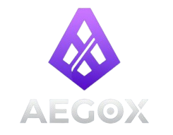

  <!-- Banner Superior con Degradado Violeta Aegox -->
  

   

  <!-- Logo Oficial de Aegox -->
  

  <h3>Building innovative tools, scalable services, and digital solutions for our global ecosystem.</h3>
  
<em>Construyendo herramientas innovadoras, servicios escalables y soluciones digitales para nuestro ecosistema global.</em>

  <!-- Botones Principales con Paleta Aegox -->
  

    
    
    
    
  

  <!-- Etiquetas de Estado y Soporte -->
  

    
    
    
  

 

### 🟣 About Aegox / Sobre Nosotros

<table>
  <tr>
    <td width="50%" valign="top">
      <h4>🇺🇸 English</h4>
      

        Welcome to the official GitHub organization of <strong>Aegox</strong>. We are a technology and digital innovation initiative dedicated to designing modern software, web platforms, automation utilities, and developer tools.
      

      

        Our mission is to deliver reliable, clean, and high-performance solutions while fostering an active, welcoming community. We provide full <strong>bilingual support in English and Spanish</strong> across all our channels.
      

    </td>
    <td width="50%" valign="top">
      <h4>🇪🇸 Español</h4>
      

        Bienvenido a la organización oficial de <strong>Aegox</strong> en GitHub. Somos una iniciativa de tecnología e innovación digital dedicada al diseño de software moderno, plataformas web, utilidades de automatización y herramientas para desarrolladores.
      

      

        Nuestra misión es ofrecer soluciones confiables, limpias y de alto rendimiento, impulsando una comunidad activa y colaborativa. Brindamos <strong>soporte bilingüe completo en inglés y español</strong> en todos nuestros canales.
      

    </td>
  </tr>
</table>

 

### 🚀 Core Pillars & Ecosystem / Pilares y Ecosistema

<table>
  <tr>
    <td width="33%" align="center" valign="top">
      <h4>🛠️ Tools & Software</h4>
      
<em>Herramientas y Software</em>

      

        Development of efficient utilities, bots, APIs, and custom applications built to streamline digital workflows.  
        <em>Desarrollo de utilidades eficientes, bots, APIs y aplicaciones diseñadas para optimizar flujos digitales.</em>
      

    </td>
    <td width="33%" align="center" valign="top">
      <h4>🌐 Web & Infrastructure</h4>
      
<em>Web e Infraestructura</em>

      

        Connected services, web portals, and scalable digital experiences centralized through <a href="https://www.aegox.org">aegox.org</a>.  
        <em>Servicios conectados, portales web y experiencias digitales escalables centralizadas en <a href="https://www.aegox.org">aegox.org</a>.</em>
      

    </td>
    <td width="33%" align="center" valign="top">
      <h4>🤝 Open Source & Community</h4>
      
<em>Código Abierto y Comunidad</em>

      

        Transparent repositories, technical documentation, and collaborative spaces for creators and developers.  
        <em>Repositorios transparentes, documentación técnica y espacios colaborativos para creadores y desarrolladores.</em>
      

    </td>
  </tr>
</table>

 

### 💡 How to Collaborate & Get Support / Cómo Colaborar y Obtener Soporte

- **🔍 Explore our Repositories / Explora nuestros repositorios:** Browse our public projects, check out the documentation, and feel free to star or fork the tools you find useful.
- **🐛 Report Issues & Ideas / Reporta errores o ideas:** Found a bug or have a feature request? Open an **Issue** in the corresponding repository or reach out to our team directly.
- **💬 Join the Conversation / Únete a la conversación:** Connect with our developers and community members on Discord for real-time assistance in **English or Spanish**.

 

### 📬 Official Channels & Directory / Canales Oficiales y Directorio

| Platform / Plataforma | Official Link / Enlace | Description / Descripción |
| :--- | :--- | :--- |
| 🌐 **Main Website** | [www.aegox.org](https://www.aegox.org) | Official portal, ecosystem overview & product launches / *Portal oficial y lanzamientos* |
| 💬 **Discord Server** | [discord.aegox.org](https://discord.aegox.org) | Live bilingual support (EN / ES) & community hub / *Soporte en vivo y comunidad* |
| 📸 **Instagram** | [@aegoxarg](https://www.instagram.com/aegoxarg/) | Visual updates, announcements & behind the scenes / *Novedades y anuncios visuales* |
| 📧 **Technical & Dev Email** | `github@aegox.org` | Direct contact for development, security & partnerships / *Contacto técnico y alianzas* |
| ⚖️ **Legal & Compliance** | [legal.aegox.org](https://legal.aegox.org) | Terms of Service, Privacy Policy & official guidelines / *Términos, privacidad y normativas* |

 

  
<strong>Thank you for visiting Aegox! / ¡Gracias por visitar Aegox!</strong>

  <!-- Banner Inferior con Degradado Violeta Aegox -->
  

